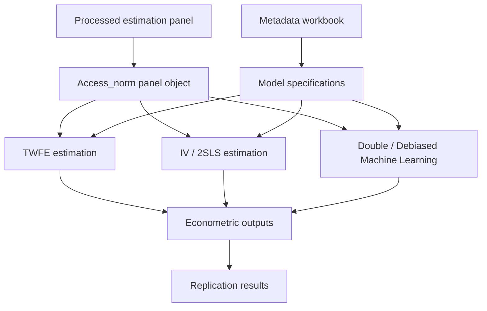

# Fuel Costs and Spatial Rail Accessibility — Replication Package

<p align="center">
  
</p>

Replication material accompanying the research article:

**Fuel Costs and Spatial Rail Accessibility: Econometric Evidence from an Empirically-Weighted Network-Based 3SFCA Model**

**Published article:** https://www.sciencedirect.com/science/article/pii/S2210539526000994

---

## Overview

This repository provides the main R scripts, estimation metadata, and supporting materials associated with the empirical analysis presented in the paper.

The study investigates the relationship between fuel costs and spatial rail accessibility using an empirically weighted network-based Three-Step Floating Catchment Area (3SFCA) framework.

The empirical analysis combines spatial accessibility indicators with three complementary econometric approaches:

- **Two-Way Fixed Effects (TWFE):** controlling for unobserved time-invariant heterogeneity and common temporal effects.
- **Instrumental Variables (IV/2SLS):** addressing potential endogeneity.
- **Double/Debiased Machine Learning (DML):** allowing flexible nuisance-function estimation within a causal estimation framework.

The repository focuses on the principal estimation procedures rather than the entire database construction process.

## Replication workflow



## Repository structure

```text
Fuel-Costs-and-Spatial-Rail-Accessibility/
│
├── code/
│   ├── 00_functions.R
│   ├── 01_twfe_metadata.R
│   ├── 02_iv_metadata.R
│   ├── 03_dml_metadata.R
│   ├── 3SFCA_panel.R
│   ├── 99_run_all.R
│   └── Meta_fusco_dm.xlsx
│
├── db/
│   └── Access_norm_cut.RData
│
├── cover.jpg
│
└── README.md
```

## Data availability

The empirical analysis relies on a processed panel dataset combining information on spatial rail accessibility, fuel costs, and additional explanatory variables.

The complete processed estimation panel is not distributed through this repository.

A reduced database is included to facilitate the inspection of the empirical framework, variable definitions, and estimation procedures.

Additional information regarding the database construction process and supporting materials can be obtained from the authors upon reasonable request, subject to applicable data-sharing restrictions.

### Reduced sample database

The repository includes:

```text
db/Access_norm_cut.RData
```

This file contains a reduced version of the processed estimation panel.

The sample database is provided for:

- Inspection of the database structure and variable names.
- Examination of the estimation workflow.
- Verification of metadata compatibility.
- Basic code-consistency checks.

**The reduced dataset is not intended to reproduce the published regression coefficients, standard errors, or statistical significance levels.**

Full empirical replication requires the original processed estimation panel.

## Metadata and econometric specifications

The estimation scripts are organized through the metadata workbook:

```text
code/Meta_fusco_dm.xlsx
```

The main specification groups are:

| Metadata sheet | Estimation approach |
|---|---|
| GENERAL | Two-Way Fixed Effects (TWFE) |
| IV | Instrumental Variables / Two-Stage Least Squares |
| DBML | Double/Debiased Machine Learning |

The metadata define the principal elements of each specification, including:

```text
dependent_var
independent_vars
control_vars
instrument_vars
interaction
```

This structure allows multiple econometric specifications to be implemented within a consistent analytical framework.

## Main R scripts

### `code/00_functions.R`

Contains auxiliary functions supporting model estimation and the organization of empirical results.

### `code/01_twfe_metadata.R`

Implements Two-Way Fixed Effects estimations based on the specifications contained in the metadata workbook.

### `code/02_iv_metadata.R`

Implements Instrumental Variables and Two-Stage Least Squares estimations.

### `code/03_dml_metadata.R`

Implements the Double/Debiased Machine Learning estimation framework.

### `code/3SFCA_panel.R`

Provides supporting procedures related to the construction and organization of the network-based spatial accessibility panel.

### `code/99_run_all.R`

Provides the main execution entry point for the available econometric estimation procedures.

## Software requirements

The empirical analysis was developed entirely in **R**.

The scripts rely on packages for:

- Data manipulation and transformation.
- Panel-data econometrics.
- Instrumental-variable estimation.
- Machine learning.
- Metadata-driven estimation.
- Statistical reporting.

Users should install the required dependencies specified in the individual scripts.

## How to run

Clone or download the repository and open the project root in R or RStudio.

To execute the main estimation workflow:

```r
source("code/99_run_all.R")
```

Alternatively, run individual estimation procedures:

```r
source("code/01_twfe_metadata.R")
source("code/02_iv_metadata.R")
source("code/03_dml_metadata.R")
```

The complete empirical analysis requires the original processed dataset and the corresponding metadata specifications.

The reduced database is intended for inspection and preliminary consistency checks.

## Replication outputs

The estimation scripts are designed to generate the econometric outputs associated with the models presented in the paper.

Depending on the specification, these outputs may include:

- Estimated coefficients.
- Standard errors and statistical significance measures.
- Model diagnostics.
- Supplementary statistical summaries.

The final published regression tables are not distributed as standalone files.

The published article remains the official reference for the reported results and their interpretation.

## Additional code availability

This repository provides the **main coding procedures used for the empirical estimations**.

The full set of coding files, including database construction routines, preprocessing procedures, auxiliary analyses, and additional robustness checks, is available from the authors upon reasonable request, subject to applicable data-sharing restrictions.

## Citation

If you use this replication material, please cite the associated research article:

**Fuel Costs and Spatial Rail Accessibility: Econometric Evidence from an Empirically-Weighted Network-Based 3SFCA Model.**

Published article: https://www.sciencedirect.com/science/article/pii/S2210539526000994
