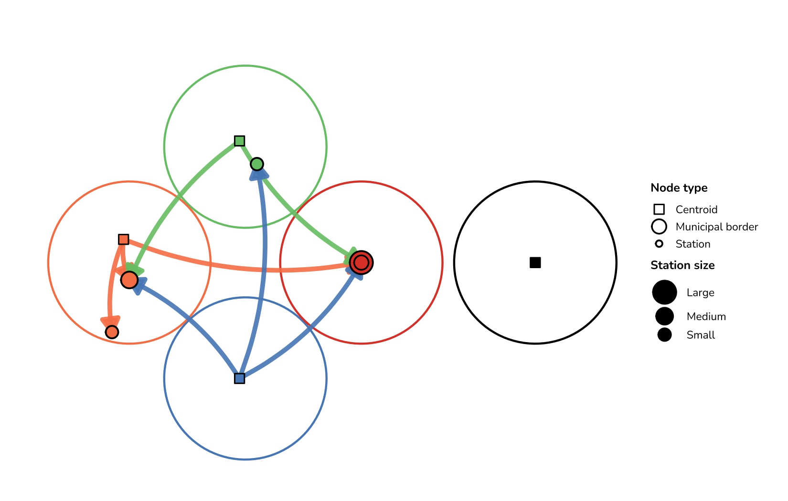
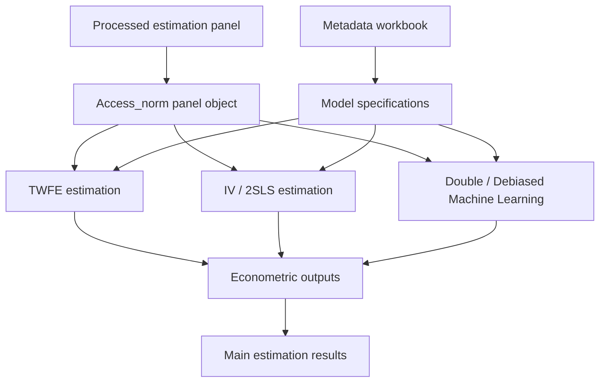

# Fuel Costs and Spatial Rail Accessibility — Replication Package

**Published in:** *Research in Transportation Business & Management* (Elsevier), Volume 67, Article 101693, 2026.

**DOI:** https://doi.org/10.1016/j.rtbm.2026.101693

**Published article:** https://www.sciencedirect.com/science/article/pii/S2210539526000994

**Authors:** Angela Stefania Bergantino, Alessandro Buongiorno, Giulio Fusco, Mario Intini, Gianluca Monturano.

**Repository:** https://github.com/gmonturano/Fuel-Costs-and-Spatial-Rail-Accessibility

---

<p align="center">
  
</p>

## About this replication package

This repository accompanies the research article:

**Fuel Costs and Spatial Rail Accessibility: Econometric Evidence from an Empirically-Weighted Network-Based 3SFCA Model.**

As stated in the published article's Data Availability section, the **main estimation code is made publicly available through this GitHub repository**.

Accordingly, this repository constitutes a **public replication package focused on the main econometric estimations**, rather than the complete computational archive underlying the study.

The **full replication package**, including the complete estimation code, database construction procedures, preprocessing routines, supplementary analyses, and additional supporting materials, is available **upon request by contacting the corresponding author directly via email**, subject to applicable data-sharing restrictions.

The reduced dataset provided here is intended for methodological inspection and code-consistency checks. It is not sufficient to reproduce the complete set of published empirical results.

---

## 1. Overview

This repository provides the principal R scripts, estimation metadata, and supporting materials associated with the econometric analysis presented in the published article.

The study investigates the relationship between fuel costs and spatial rail accessibility across Italian municipalities over the period **2016–2024**.

The analysis develops an empirically weighted, network-based Three-Step Floating Catchment Area (3SFCA) framework, resulting in an Italian Rail Accessibility Index (EN–3SFCA).

The accessibility measure accounts for railway service availability and network-based travel times, allowing the analysis to capture spatial differences in potential accessibility to the national railway network.

The empirical framework combines the accessibility index with fuel prices, socioeconomic characteristics, and infrastructural controls.

Three complementary econometric approaches are considered:

- **Two-Way Fixed Effects (TWFE):** controls for time-invariant territorial heterogeneity and common temporal effects.
- **Instrumental Variables (IV/2SLS):** addresses potential endogeneity in the relationship between fuel costs and rail accessibility.
- **Double/Debiased Machine Learning (DML):** combines flexible nuisance-function estimation with an econometric framework for estimating parameters of interest.

The public repository focuses on these principal estimation procedures. It does not reproduce the entire upstream data-processing and spatial-index construction pipeline.

---

## 2. Scope of public replication

The repository is designed to document the main empirical estimation procedures reported in the published paper.

### Publicly available materials

The repository provides:

- Main R scripts for the econometric estimations.
- Metadata-driven model specifications.
- Supporting estimation functions.
- A reduced processed panel dataset.
- Documentation describing the analytical workflow.
- References to the published article and its empirical framework.

### Materials available upon request

The complete replication package is not distributed publicly in this repository.

The full package includes, where applicable:

- Complete original estimation datasets.
- Database construction and merging procedures.
- Data cleaning and preprocessing scripts.
- Spatial accessibility index construction routines.
- Complete econometric estimation scripts.
- Additional model specifications.
- Robustness and sensitivity analyses.
- Supporting computational materials used in the study.

**Researchers seeking the complete replication package should contact the corresponding author directly via email.**

Requests for restricted or third-party data are subject to the relevant licensing, confidentiality, and data-sharing conditions. Availability upon request does not imply unrestricted redistribution rights.

---

## 3. Replication workflow

The public replication workflow is structured around the processed estimation panel and the metadata defining the econometric specifications.



This workflow describes the **main estimation stage** of the research.

The construction of the complete estimation panel and the underlying EN–3SFCA accessibility index is part of the broader computational framework and is not fully reproduced by the reduced public package.

---

## 4. Repository structure

```text
Fuel-Costs-and-Spatial-Rail-Accessibility/
│
├── code/
│   ├── 00_functions.R
│   ├── 01_twfe_metadata.R
│   ├── 02_iv_metadata.R
│   ├── 03_dml_metadata.R
│   ├── 3SFCA_panel.R
│   ├── 99_run_all.R
│   └── Meta_fusco_dm.xlsx
│
├── db/
│   └── Access_norm_cut.RData
│
├── Mappe_descrnetwork_EN3SFCA_DIRECTIONAL_FINAL_WITH_BORDER_page-0001.jpg
│
└── README.md
```

The repository is organized to distinguish estimation scripts, metadata, and supporting data.

The publicly available files provide access to the principal estimation methodology without requiring the distribution of the complete original research database.

---

## 5. Data availability

The empirical analysis relies on a processed municipal panel dataset integrating information on:

- Spatial accessibility to the railway network.
- Fuel prices.
- Socioeconomic characteristics.
- Territorial and infrastructural controls.
- Additional variables required by the econometric specifications.

The full processed estimation panel is **not publicly distributed through this repository**.

A reduced version of the dataset is provided to allow users to inspect the underlying data structure and understand the implementation of the estimation scripts.

### 5.1 Reduced sample database

The repository includes:

```text
db/Access_norm_cut.RData
```

This file contains a reduced version of the processed estimation panel.

It can be used to:

- Inspect variable names and data structures.
- Examine the organization of the estimation dataset.
- Assess compatibility between the data and metadata.
- Understand the implementation of the main estimation routines.
- Perform preliminary code-consistency checks.

**Important:** The reduced dataset is not intended to reproduce the numerical results reported in the published paper.

In particular, coefficients, standard errors, statistical significance levels, and model diagnostics obtained from the reduced dataset should not be interpreted as replications of the published estimates.

Exact empirical replication requires the complete original estimation panel and the relevant research materials.

### 5.2 Access to complete replication materials

The full replication package may be requested by contacting the corresponding author directly via email.

Requests should identify the article by its title or DOI and specify the intended research or replication purpose.

Access to the underlying data and supplementary materials remains subject to applicable data-sharing restrictions.

---

## 6. Metadata and econometric specifications

The main estimation scripts are organized through the metadata workbook:

```text
code/Meta_fusco_dm.xlsx
```

The workbook contains the model specifications associated with the principal estimation approaches.

| Metadata sheet | Estimation approach |
|---|---|
| `GENERAL` | Two-Way Fixed Effects (TWFE) |
| `IV` | Instrumental Variables / Two-Stage Least Squares |
| `DBML` | Double/Debiased Machine Learning |

The metadata provide structured information concerning the econometric specifications, including fields such as:

```text
dependent_var
independent_vars
control_vars
instrument_vars
interaction
```

Depending on the estimation method, these fields identify:

- The dependent variable.
- Main explanatory variables.
- Additional controls.
- Instrumental variables.
- Interaction terms.
- Model-specific settings.

The metadata-driven approach facilitates consistency across alternative specifications and makes the principal econometric models easier to inspect.

---

## 7. Main R scripts

### `code/00_functions.R`

Contains supporting functions used by the econometric estimation routines.

These functions assist with the organization and execution of the main empirical models.

### `code/01_twfe_metadata.R`

Implements the Two-Way Fixed Effects specifications defined in the metadata workbook.

The models account for unobserved time-invariant heterogeneity and common temporal variation.

### `code/02_iv_metadata.R`

Implements the Instrumental Variables and Two-Stage Least Squares estimation procedures.

These specifications are used to address potential endogeneity concerns within the empirical framework.

### `code/03_dml_metadata.R`

Implements the Double/Debiased Machine Learning estimation framework.

The approach incorporates flexible estimation of nuisance components while targeting the econometric parameters of interest.

### `code/3SFCA_panel.R`

Contains supporting code related to the organization and construction of the spatial accessibility panel.

It should not be interpreted as a complete reproduction of all upstream spatial data-processing procedures.

### `code/99_run_all.R`

Provides the main execution entry point for the available estimation procedures.

The script organizes the execution of the principal econometric models included in the public repository.

---

## 8. Software requirements

The empirical analysis was developed in **R**.

The estimation scripts use packages associated with:

- Data manipulation and transformation.
- Panel-data econometrics.
- Fixed-effects estimation.
- Instrumental-variable methods.
- Machine learning.
- Excel metadata import.
- Statistical reporting.

Users should install the dependencies referenced by the individual scripts before executing the estimation procedures.

**RStudio** is recommended as a development environment but is not required.

---

## 9. How to run the code

Clone the repository:

```bash
git clone https://github.com/gmonturano/Fuel-Costs-and-Spatial-Rail-Accessibility.git
```

Open the repository root as the working directory in R or RStudio.

To execute the main estimation workflow:

```r
source("code/99_run_all.R")
```

Alternatively, run the estimation scripts individually:

```r
source("code/01_twfe_metadata.R")
source("code/02_iv_metadata.R")
source("code/03_dml_metadata.R")
```

The scripts should be executed with the corresponding metadata and a dataset containing the required variables.

### Important replication limitation

The public sample database is supplied primarily for inspection, methodological transparency, and preliminary consistency checks.

**Successful execution of the full empirical specifications and reproduction of the published results require the complete original processed dataset.**

The public repository should therefore be understood as providing the **main estimation code**, not a self-contained archive capable of reproducing every table and figure in the article.

Researchers requiring the complete computational materials should request the full replication package directly from the corresponding author.

---

## 10. Replication outputs

Depending on the model and estimation procedure, the scripts are designed to produce econometric outputs such as:

- Estimated regression coefficients.
- Standard errors.
- Statistical significance measures.
- Model diagnostics.
- Supplementary estimation summaries.

The numerical results obtained using the reduced dataset may differ substantially from those presented in the paper.

The published article provides the authoritative reference for the reported empirical results, their interpretation, and the associated conclusions.

---

## 11. Full replication package — available upon request

**The present GitHub repository contains the publicly released main estimation code, consistent with the Data Availability statement of the published article.**

It does **not** contain the full replication package.

The complete replication package encompasses the broader computational materials required for full empirical replication, including the original processed data, data-construction procedures, preprocessing scripts, complete estimation routines, and supporting robustness analyses, where these materials can lawfully be shared.

**To request the full replication package, please contact the corresponding author directly by email.**

When submitting a request, please refer to:

**Fuel Costs and Spatial Rail Accessibility: Econometric Evidence from an Empirically-Weighted Network-Based 3SFCA Model**

DOI: https://doi.org/10.1016/j.rtbm.2026.101693

Access to the full materials is subject to applicable data availability, licensing, confidentiality, and redistribution conditions.

---

## 12. Citation

If you use the code, metadata, or supporting replication materials provided in this repository, please cite the associated research article:

Bergantino, A. S., Buongiorno, A., Fusco, G., Intini, M., & Monturano, G. (2026).

**Fuel costs and spatial rail accessibility: Econometric evidence from an empirically-weighted network-based 3SFCA model.**

*Research in Transportation Business & Management, 67*, 101693.

https://doi.org/10.1016/j.rtbm.2026.101693

### BibTeX

```bibtex
@article{bergantino2026fuel,
  title   = {Fuel costs and spatial rail accessibility:
             Econometric evidence from an empirically-weighted
             network-based 3SFCA model},
  author  = {Bergantino, Angela Stefania and
             Buongiorno, Alessandro and
             Fusco, Giulio and
             Intini, Mario and
             Monturano, Gianluca},
  journal = {Research in Transportation Business \& Management},
  volume  = {67},
  pages   = {101693},
  year    = {2026},
  doi     = {10.1016/j.rtbm.2026.101693},
  url     = {https://doi.org/10.1016/j.rtbm.2026.101693}
}
```

---

## 13. Contact and research inquiries

For questions about the main estimation code, metadata specifications, or access to the complete replication package, please contact the corresponding author directly.

**Full replication materials must be requested by email and are not automatically included in the public GitHub repository.**

Please include the article title, DOI, and a brief description of the requested materials in your message.

---

**Repository scope:** Public main-estimation replication code.

**Full replication package:** Available upon direct email request, subject to applicable data-sharing restrictions.

**Official publication:** https://doi.org/10.1016/j.rtbm.2026.101693
